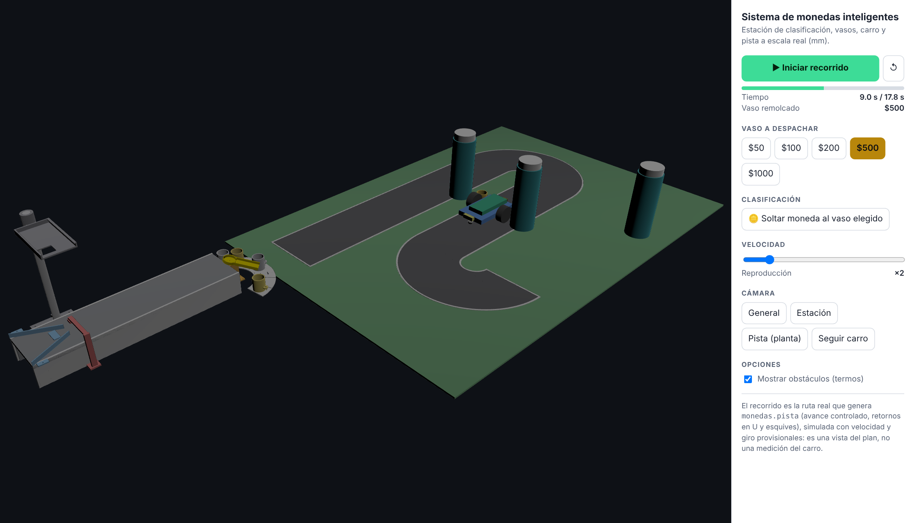
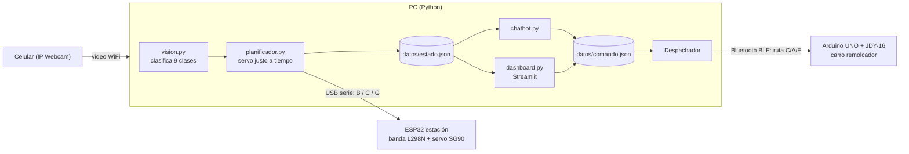
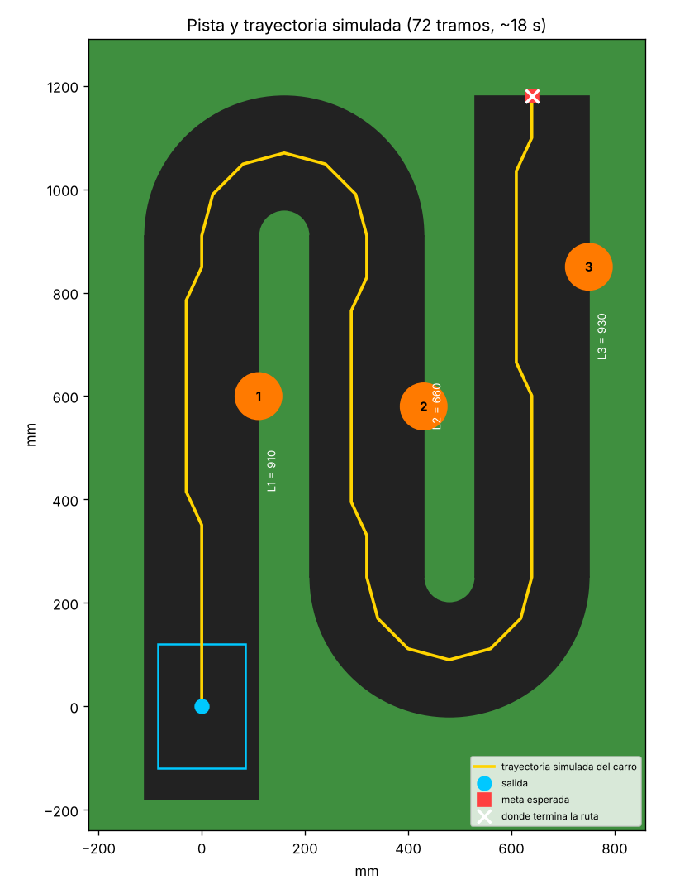

# Sistema logístico de monedas inteligentes

Proyecto de curso · Ingeniería Mecatrónica · Universidad Militar Nueva Granada (UMNG) · Autor: Kevin

Una banda transporta cada moneda frente a la cámara de un celular; el software la **clasifica** (9 clases:
$50, $100, $200 y $500 antiguas y actuales, y $1000), una **canaleta con servo** la deja en el vaso de su
denominación (5 vasos) y, cuando el **chatbot** recibe la orden, un **carro** remolca el vaso elegido por una pista
con dos retornos en U y tres obstáculos. Un **tablero Streamlit** muestra cantidad, peso, valor y la posición del carro.



> **Pruébalo ya, sin hardware:** abre [`docs/visor3d.html`](docs/visor3d.html) con doble clic (visor 3D con el carro
> recorriendo la pista) o ejecuta `python -m monedas --demo` (todo el sistema con cámara, banda y carro simulados).

## Estado real (léelo antes de armar nada)

| Parte | Estado |
|---|---|
| Software (visión, planificador, despacho, chatbot, tablero, generador de ruta) | Funciona en **demo/simulación**; 80 pruebas automáticas pasan. La visión con monedas reales se calibró en el banco con la cámara del celular. |
| Firmware ESP32 (estación) y Arduino UNO (carro) | Revisados y consistentes con el software por pruebas estáticas, **sin compilar ni probar en CI**; la estación se ha movido (banda y servo se mueven), la banda aún no arrastra bien. |
| Piezas 3D (STL) | **Generadas por código y validadas en la malla** (herméticas, caben en 220 mm, sin choques de la canaleta). **No se han impreso.** Las medidas marcadas `[?]` en `cad/parametros.py` son supuestos: verifícalos con pie de rey. |
| Pista | Largos medidos de los tramos rectos (91 / 66 / 93 cm); separación entre ejes (32 cm) y velocidad/giro del carro son **provisionales**. |
| Carro | Falta ajustar el factor de ruedas `K` (el carro se desvía): ver [docs/problemas.md](docs/problemas.md). |
| Pendiente de la canaleta | **14°**, limitada por la altura de la banda (80 mm). Es poca: usa superficie lisa; ver [docs/cad.md](docs/cad.md). |

## Cumplimiento de la especificación

El requisito (sistema contador funcional con transporte y embalaje, recolección y direccionamiento a la meta, con análisis
mecánico, eléctrico y de software por etapa y la importancia del ESP32) se desarrolla en
**[docs/analisis_por_etapas.md](docs/analisis_por_etapas.md)**, con una matriz de cumplimiento al final. El ESP32 es el
corazón de la estación (banda + servo + sensor); el carro todavía usa Arduino UNO y el documento explica la mejora.

Los **cálculos de ingeniería** (autonomía del carro, consumo, caudal de la banda, capacidad de vasos, resolución de la visión)
están en **[docs/calculos.md](docs/calculos.md)** y se recalculan con tus mediciones: `python -m monedas.calculos --bateria-mah 2600`.

## Arquitectura



El **contrato** entre procesos son dos archivos JSON en `datos/`: `estado.json` (lo publica el sistema cada 0,25 s y lo
leen el chatbot y el tablero) y `comando.json` (`{"accion":"despachar","tipo":"500_actual","atendido":false}`).
Más detalle en [docs/arquitectura.md](docs/arquitectura.md).

## Inicio rápido

```bash
pip install -r requirements.txt        # Python 3.10+
pip install -e .                        # opcional: instala los comandos monedas / monedas-pista / monedas-chatbot

python -m monedas --demo                # sistema completo simulado (ventanas OpenCV; Q para salir)
streamlit run monedas/dashboard.py      # tablero (otra terminal)
python -m monedas.chatbot               # chatbot: escribe "despacha el de 500"  (otra terminal)
```

Con hardware real (detalle en [docs/puesta_en_marcha.md](docs/puesta_en_marcha.md)):

```bash
python -m monedas --fuente http://192.168.1.50:8080/video --puerto COM5 --carro-nombre JDY
```

(usa la IP **de la red local** que muestra IP Webcam, no una IP pública.)

## Estructura

| Ruta | Contenido |
|---|---|
| `monedas/` | Paquete Python: `vision`, `clases`, `planificador`, `hardware`, `pista`, `chatbot`, `dashboard`, `sistema`, `demo` |
| `firmware/estacion_esp32/` | ESP32: banda (L298N) + servo SG90 + sensor de presencia; protocolo serie `B/C/G/S/H/L/?` |
| `firmware/carro_monedas/` | Arduino UNO: motores, BLE JDY-16, rutas `C/A/E`, `K` (factor de ruedas en EEPROM) |
| `firmware/carro_diagnostico/` | Sketch mínimo para probar ruedas, sentido y `K` |
| `herramientas/panel_carro.html` | Panel web (Web Bluetooth) para mover el carro y mandarle la ruta |
| `cad/` | `parametros.py` + `generar_cad.py` → STL, `escena.glb`, `PIEZAS.md` |
| `visor3d/` | Fuente del visor (three.js) y `construir.py` que lo empaqueta en `docs/visor3d.html` |
| `docs/` | Análisis por etapas, guías, diagramas y capturas |
| `tests/` | 80 pruebas (software, protocolo del carro, firmware↔software, CAD) |
| `legacy/` | Versión anterior (carrusel de 9 cubículos + PyBullet), conservada como referencia |

## Piezas 3D

`python cad/generar_cad.py --check` genera en `cad/stl/` las piezas a imprimir y valida la malla:

| Pieza | Cant. | Para qué |
|---|---|---|
| `vaso` | 5 | Vaso Ø42×45 con oreja de enganche (guarda la moneda actual **y** la antigua de su valor) |
| `placa_portavasos_A/B/C` | 3 | Arco que sostiene los 5 vasos (3 tramos, cada uno cabe en una cama de 220 mm) |
| `torre_servo` + `canaleta` | 1+1 | Servo SG90 sobre torre y tolva giratoria con canal hacia el vaso |
| `tolva_entrada` | 1 | Embudo que deja pasar una moneda por vez |
| `soporte_sensor_ir` | 1 | Sensor de presencia sobre la banda |
| `base_poste_celular` + `soporte_celular` | 1+1 | Poste y bandeja para el celular mirando hacia abajo |
| `enganche_carro` | 1 | Pasador para la parte trasera del carro que entra en la oreja del vaso |

Medidas y volúmenes en [cad/PIEZAS.md](cad/PIEZAS.md); decisiones y límites en [docs/cad.md](docs/cad.md).

## Calibrar la visión (resumen)

Ventana de video, teclas: `F` fondo (banda vacía) · `1–5` elegir denominación · `A` alterna actual/antigua · `M` modo ·
`D` sentido · `R` reiniciar · `B` banda · `T` probar servo · `Q` salir. Se pone cada moneda sola en la banda y se
guarda su tamaño y color. Los pares más confundibles son **$100 antigua vs $500 antigua** (2,4 % de diferencia de
tamaño) y **$200 vs $500**. Usa una cubierta lisa y mate (cartulina) sobre la banda negra texturizada.
Guía completa: [docs/calibracion.md](docs/calibracion.md).

## Pista y carro

`python -m monedas.pista` calcula la ruta (avance controlado con corrección a la izquierda, retornos en U por pasos de
30° y esquives) y escribe el plano y las órdenes Bluetooth. Se parametriza en `monedas/pista.py` y se explica en
[docs/pista.md](docs/pista.md).



## Pruebas

```bash
pip install -r requirements-dev.txt
python -m pytest        # 80 pruebas, ~1 min
ruff check .
```

CI en `.github/workflows/ci.yml` (pytest, ruff, demo sin ventana, generación de CAD y del visor).

## Lista de materiales (estimada)

ESP32 · L298N · motorreductor de banda · servo SG90 · sensor IR de presencia (LM393/FC-51) · Arduino UNO + shield
LAFVIN 2WD · módulo BLE JDY-16 · sensor de distancia frontal del carro · celular con IP Webcam · cartulina mate ·
filamento PLA/PETG · 3 termos Stanley de 0,9 L como obstáculos.

## Licencia

MIT. Ver [LICENSE](LICENSE).
