<div align="center">

# 🪙 Sistema logístico de monedas inteligentes

**Una banda, una cámara, un servo, cinco vasos y un carro que los lleva a la meta.**

Proyecto de curso · Ingeniería Mecatrónica · Universidad Militar Nueva Granada (UMNG)

[](https://github.com/kevinvega-05/PROYECTO-FINAL/actions)


[**Visor 3D interactivo**](docs/visor3d.html) · [Análisis por etapas](docs/analisis_por_etapas.md) · [Cálculos](docs/calculos.md) · [Puesta en marcha](docs/puesta_en_marcha.md) · [Piezas 3D](cad/PIEZAS.md)

</div>

---

## En 30 segundos

1. Una **banda** lleva cada moneda, de a una, frente a la **cámara de un celular**.
2. **OpenCV** mide su diámetro y su color y la clasifica en **9 clases** (\$50, \$100, \$200 y \$500 *antiguas y actuales*, y \$1000).
3. Una **canaleta con servo SG90**, movida por un **ESP32**, la deja en el **vaso de su denominación** (5 vasos).
4. El **tablero** (Streamlit) cuenta monedas, peso y valor en tiempo real.
5. Cuando el **chatbot** recibe *«despacha el de 500»*, un **carro** se engancha al vaso, lo **remolca por una pista con dos retornos en U y tres obstáculos** y llega a la meta.

> 🎮 **Pruébalo sin hardware:** abre [`docs/visor3d.html`](docs/visor3d.html) con doble clic (el carro recorre la pista en 3D) o ejecuta
> `python -m monedas --demo` (cámara, banda y carro simulados).

## Lo que ya existe en la vida real

Esto **no es solo simulación**: son las fotos y pruebas del montaje físico del equipo.

<table>
<tr>
<td width="50%">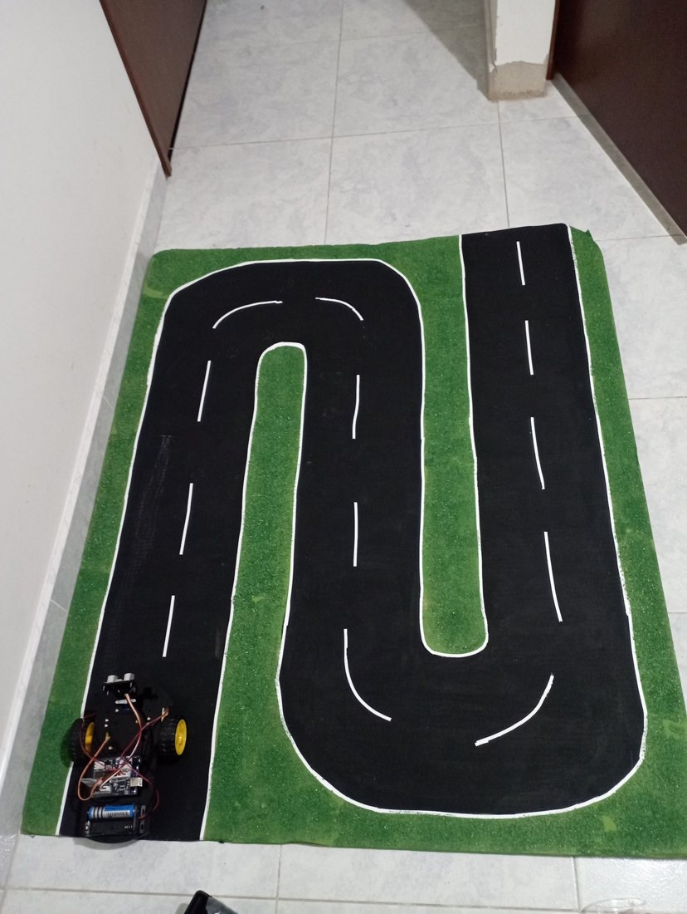<br><sub><b>La pista real</b>, tres tramos rectos de 22 cm de carril, dos retornos en U y el carro en la salida.</sub></td>
<td width="50%">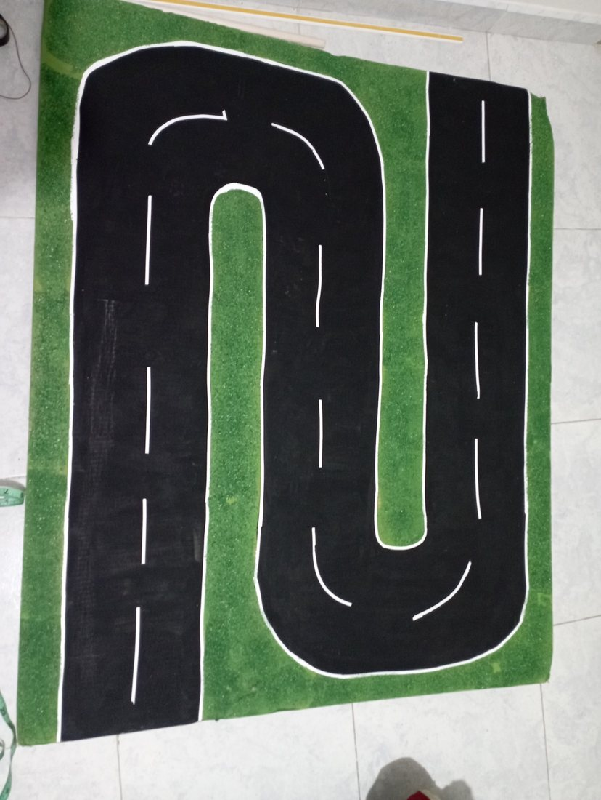<br><sub><b>Vista desde arriba:</b> tramos de 91 / 66 / 93 cm de donde sale la geometría de <code>monedas/pista.py</code>.</sub></td>
</tr>
<tr>
<td>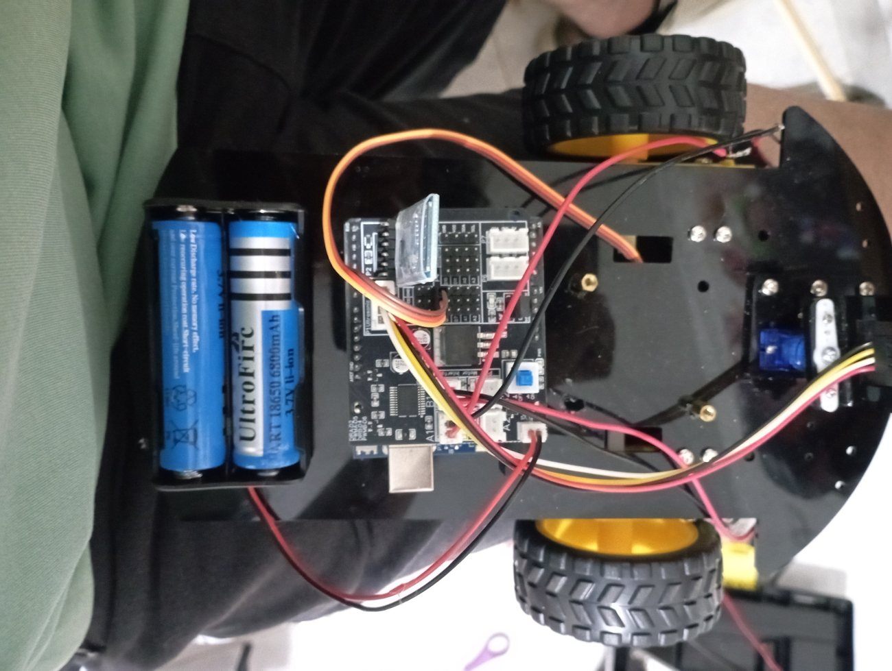<br><sub><b>El carro</b>: chasis 2WD, Arduino UNO + shield, módulo Bluetooth y dos celdas 18650 (ver <a href="docs/calculos.md">autonomía</a>).</sub></td>
<td>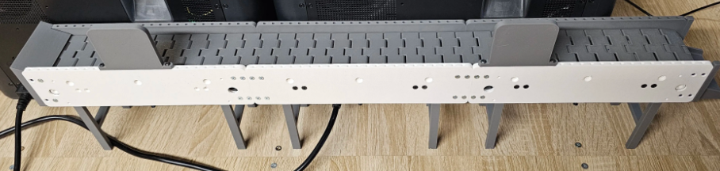<br><sub><b>La banda</b> modular de 3 módulos (22 cm c/u, 16 cm de ancho, 8 cm de alto) ya armada.</sub></td>
</tr>
<tr>
<td colspan="2" align="center">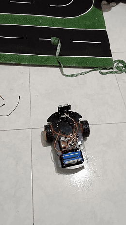<br><sub><b>El carro en la pista</b> (video del 23-nov) probando el avance controlado. Esa prueba mostró que se desvía, y de ahí salió el factor de ruedas <code>K</code> y la corrección <code>L40</code>.</sub></td>
</tr>
</table>

### La visión, antes y después

<table>
<tr>
<td width="50%">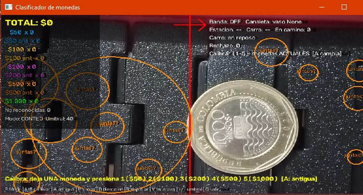<br><sub><b>Antes:</b> sobre la banda negra texturizada, Hough inventa círculos («¿juntas?») y no se logra calibrar.</sub></td>
<td width="50%">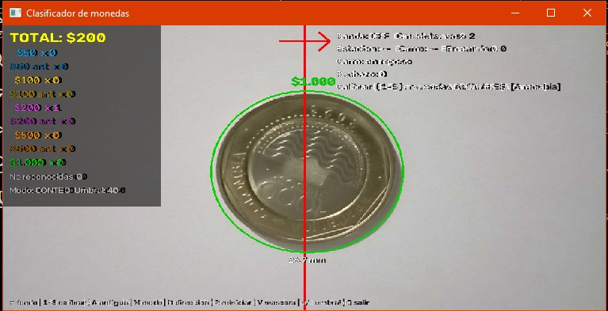<br><sub><b>Después:</b> con fondo liso y mate, la moneda de <b>\$1.000</b> se mide (26,7 mm) y se clasifica bien.</sub></td>
</tr>
</table>

> Lección de ingeniería: **el problema era mecánico, no de software.** Una cubierta de cartulina mate resolvió lo que ningún umbral arreglaba.

## Arquitectura

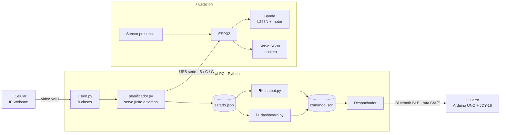

El **contrato** entre procesos son dos archivos JSON en `datos/`: `estado.json` (lo publica el sistema cada 0,25 s) y
`comando.json` (`{"accion":"despachar","tipo":"500_actual","atendido":false}`). Cualquier interfaz nueva solo necesita leer y escribir esos dos archivos.

### La vida de una orden de despacho

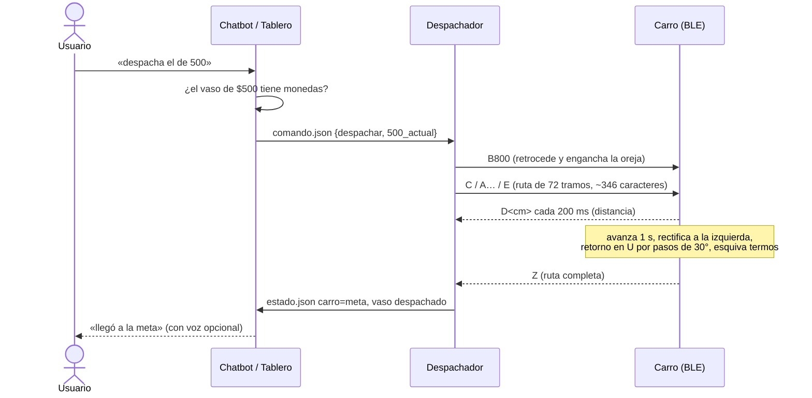

## Las cuatro etapas: mecánico, eléctrico y software

Resumen aquí; el detalle completo está en **[análisis por etapas](docs/analisis_por_etapas.md)**, **[diseño eléctrico](docs/electrico.md)** y **[código por etapas](docs/software.md)**.

### Etapa 1 · Conteo e identificación

* 🔩 **Mecánico:** poste y bandeja del celular mirando hacia abajo, embudo que deja pasar una moneda por vez y fondo liso y mate sobre la banda.
* ⚡ **Eléctrico:** el sensor de presencia LM393 entra por **GPIO34** (solo entrada, activo en bajo); el celular se alimenta aparte y manda el video por WiFi.
* 💻 **Software:** `vision.py` resta el fondo, detecta círculos (Hough), calcula el diámetro en mm y la fracción dorada y clasifica en 9 clases; `estado.py` cuenta, pesa y suma el valor.

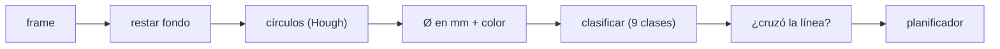

<details><summary>Ver el código de la clasificación</summary>

```python
for v, ref in refs.items():
    err_tam = abs(d - ref["d"]) / ref["d"]
    if err_tam > TOL_TAMANO:
        continue
    err_color = abs(oro - ref["oro"])
    puntaje = err_tam / TOL_TAMANO + PESO_COLOR * err_color
    if puntaje < mejor_puntaje:
        mejor, mejor_puntaje = v, puntaje
```
</details>

### Etapa 2 · Transporte (banda)

* 🔩 **Mecánico:** banda modular de 660 mm a 20 mm/s: 33 s de recorrido y 15 s de la línea de lectura al borde.
* ⚡ **Eléctrico:** ESP32 → **L298N** (`ENA` GPIO18 con PWM de 1 kHz, `IN1` GPIO19, `IN2` GPIO21) → motorreductor TT. El L298N cae ≈ 2 V, por eso `PWM_MIN = 90`.
* 💻 **Software:** el ESP32 sube y baja el PWM en **rampa** sin `delay`; el PC solo manda `B <0-100>`.

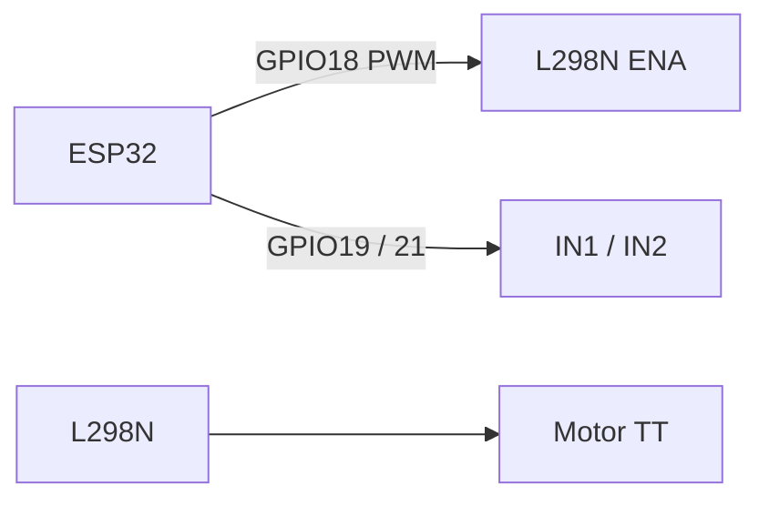

<details><summary>Ver el código de la rampa de la banda</summary>

```cpp
void actualizarBanda() {
  if (dutyBanda == dutyObjetivo || millis() - tRampa < PASO_RAMPA_MS) return;
  tRampa = millis();
  dutyBanda += (dutyObjetivo > dutyBanda) ? 1 : -1;
  escribirBanda(dutyBanda);
}
```
</details>

### Etapa 3 · Embalaje (canaleta con servo)

* 🔩 **Mecánico:** tolva giratoria y canal con **14°** de pendiente, 5 vasos Ø42×45 en un arco de R = 110 mm (ángulos 20/45/90/135/160°). Cada vaso guarda la moneda **actual y la antigua** de su valor.
* ⚡ **Eléctrico:** servo SG90 en **GPIO23** (50 Hz, 14 bits), +5 V del cargador (no del USB), GND común y un condensador de 470–1000 µF; hasta 650 mA al bloquearse.
* 💻 **Software:** `Planificador` gira la canaleta justo antes de que llegue la moneda (`C <k>`) y manda las no reconocidas al ángulo de rechazo.

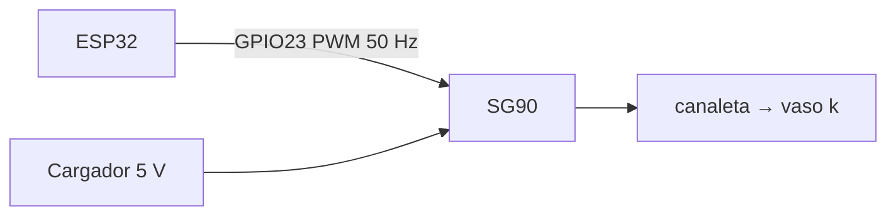

<details><summary>Ver el código del servo y del planificador</summary>

```cpp
void escribirServo(int grados) {
  grados = constrain(grados, 0, 180);
  long pulso_us = 500L + (long)grados * (2400L - 500L) / 180L;   // SG90: 0.5-2.4 ms
  int duty = (int)(pulso_us * 16383L / 20000L);
  ledcWrite(PIN_SERVO, duty);
}
```

```python
k = cfg.cubiculo_de_valor(mc.valor_de(clave))
self._esperar_hasta(llegada - cfg.TIEMPO_SERVO_S)
if k is None:
    self.estacion.angulo(cfg.ANGULO_RECHAZO)
else:
    self.estacion.cubiculo(k)
self._esperar_hasta(max(llegada, time.time()) + cfg.TIEMPO_CAIDA_S)
self.estado.moneda_llego(clave, k)
```
</details>

### Etapa 4 · Recolección y llegada a la meta

* 🔩 **Mecánico:** el carro (170 × 240 mm) retrocede, engancha la **oreja** del vaso con un pasador Ø5,4 y lo remolca ≈ 0,9 N por 3 tramos rectos, 2 retornos en U y 3 termos.
* ⚡ **Eléctrico:** Arduino UNO + shield LAFVIN (motores en D2/D5 y D4/D6), sensor de distancia (D12/D13), servo del sensor (D10), módulo BLE JDY-16 en D0/D1 a 9600 baudios y 2 celdas 18650.
* 💻 **Software:** `pista.py` genera la ruta (`F/B/L/R/S` + ms), `CarroBLE` la envía en trozos de 20 bytes, el firmware la ejecuta y el `Despachador` marca el vaso como despachado cuando llega a la meta.

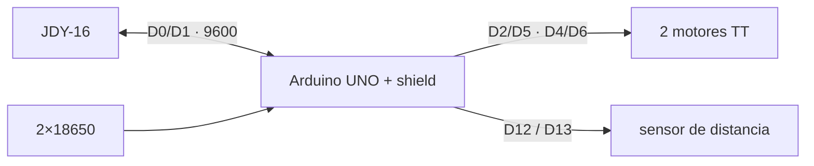

<details><summary>Ver el código de la ruta y del carro</summary>

```python
def avance(mm):
    ms = ms_dist(mm)
    toks = []
    for _ in range(ms // PASO_RECTO_MS):
        toks += [("F", PASO_RECTO_MS), ("L", CORRECCION_IZQ_MS)]   # 1 s adelante + rectificar
    ...
```

```cpp
void aplicarTramo(byte i) {
  switch (ruta[i].c) {
    case 'F': velIzq = velAdelante;  velDer = velAdelante;  break;
    case 'B': velIzq = -velReversa;  velDer = -velReversa;  break;
    case 'L': velIzq = -velGiro;     velDer = velGiro;      break;
    case 'R': velIzq = velGiro;      velDer = -velGiro;     break;
    default:  velIzq = 0;            velDer = 0;
  }
  finTramo = millis() + ruta[i].ms;
}
```
</details>

### ⚡ Mapa de pines

| Placa | Pin | Función |
|---|---|---|
| ESP32 | GPIO18 / 19 / 21 | `ENA` (PWM) / `IN1` / `IN2` del L298N (banda) |
| ESP32 | GPIO23 | Servo SG90 de la canaleta |
| ESP32 | GPIO34 | Sensor de presencia (solo entrada) |
| Arduino UNO | D2 / D5 · D4 / D6 | Motor izquierdo (dir/PWM) · motor derecho (dir/PWM) |
| Arduino UNO | D12 / D13 · D10 | TRIG / ECHO del sensor de distancia · servo del sensor |
| Arduino UNO | D0 / D1 | JDY-16 (BLE, 9600 baudios) |

### ⚡ Por qué el ESP32

| | ESP32 (estación) | Arduino UNO (carro) |
|---|---|---|
| Procesador | 240 MHz, 2 núcleos | 16 MHz |
| SRAM | ≈ 520 kB | 2 kB |
| PWM | LEDC: frecuencia y resolución por canal | 6 canales de 8 bits, timers compartidos |
| Radio | WiFi + BLE integrados | ninguna (módulo JDY-16 externo) |

En la estación hay que mover una banda **suave** (1 kHz) y un servo **preciso** (50 Hz, 14 bits) *a la vez*, leer un sensor y atender el PC: el ESP32 lo hace con dos canales LEDC y un bucle cooperativo sin `delay`. Migrar también el carro a ESP32 es la mejora más valiosa pendiente.

## Números clave

*(detalle y fórmulas en [docs/calculos.md](docs/calculos.md); recalcúlalo con tus mediciones: `python -m monedas.calculos --bateria-mah 1500`)*

| | |
|---|---|
| Autonomía del carro | **≈ 2,1 h** moviéndose · **≈ 290 viajes** por carga (celdas de ≈ 1500 mAh reales) |
| Un viaje a la meta | **17,8 s**, ≈ 3,5 m de recorrido, 72 tramos |
| Caudal de la banda | **0,5 moneda/s** ≈ 1800 monedas/h, 250 cuadros de video por moneda |
| Cámara | par crítico \$100 ant. vs \$500 ant.: 0,5 mm = **6,4 σ** a 1280 px |
| Corriente de la estación | 0,67 A normal · 1,57 A peor caso (cargador de 2 A) |
| Capacidad de un vaso | de 24 monedas de \$1000 a 56 de \$50 |
| Pendiente de la canaleta | **14°** (limitada por la altura de la banda) |

## Gemelo digital en 3D

`python cad/generar_cad.py` genera **11 piezas STL** imprimibles y la escena completa; [`docs/visor3d.html`](docs/visor3d.html) la muestra a escala real
con el carro recorriendo **la misma ruta** que se envía por Bluetooth, la canaleta apuntando al vaso elegido y una moneda que cae.

<table>
<tr>
<td width="50%">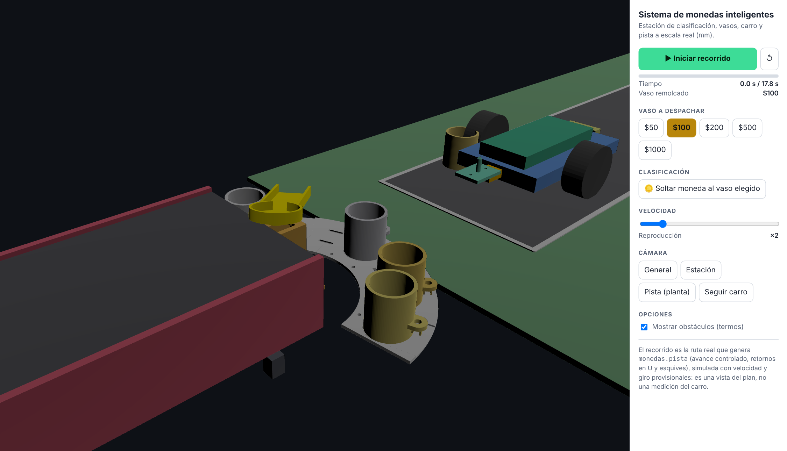<br><sub>Estación: banda, torre del servo, canaleta y 5 vasos.</sub></td>
<td width="50%">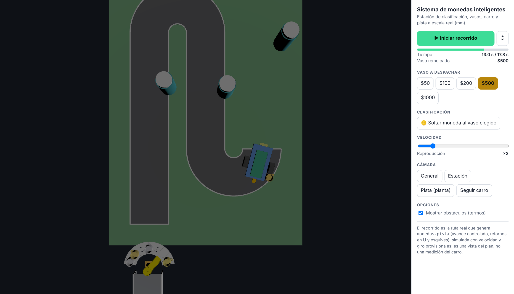<br><sub>Pista en planta con los 3 termos y el carro en recorrido.</sub></td>
</tr>
</table>

| Pieza | Cant. | Para qué |
|---|---|---|
| `vaso` | 5 | Ø42×45 con oreja de enganche; guarda la moneda **actual y la antigua** de su valor |
| `placa_portavasos_A/B/C` | 3 | Arco de los 5 vasos, en 3 tramos que caben en una cama de 220 mm |
| `torre_servo` + `canaleta` | 2 | SG90 sobre torre hueca y tolva giratoria con canal |
| `tolva_entrada` | 1 | Embudo: una moneda por vez |
| `soporte_sensor_ir` | 1 | Sensor de presencia sobre la banda |
| `base_poste_celular` + `soporte_celular` | 2 | Cámara del celular mirando hacia abajo |
| `enganche_carro` | 1 | Pasador de remolque que entra en la oreja del vaso |

Todas pasan una validación automática de malla (herméticas, caben en 220 mm, la canaleta no choca a ningún ángulo). Medidas en [cad/PIEZAS.md](cad/PIEZAS.md).

## Tablero en tiempo real

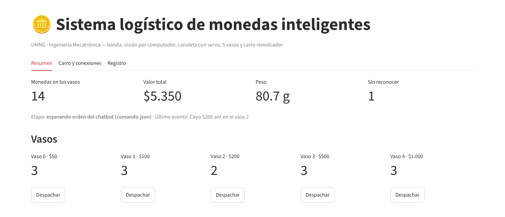

<sub>Captura real del tablero con el sistema en modo demostración: monedas, valor, peso, estado y botón de despacho por vaso.</sub>

## La pista: de la foto al código

<table>
<tr>
<td width="50%"><br><sub>La pista real, con sus tres tramos rectos y dos retornos en U.</sub></td>
<td width="50%"><br><sub>Plano y trayectoria generados por <code>python -m monedas.pista</code>.</sub></td>
</tr>
</table>

`monedas/pista.py` convierte las medidas de la pista real en órdenes `F/B/L/R/S` + milisegundos: **avance controlado** (1 s adelante y una corrección a la izquierda, porque el carro se desvía a la derecha),
**retornos en U** por pasos de 30° y **esquives** de los 3 termos Stanley de 900 ml (Ø90 mm). Detalle en [docs/pista.md](docs/pista.md).

## Estado real

| Parte | Estado |
|---|---|
| Software (visión, planificador, despacho, chatbot, tablero, ruta) | ✅ Funciona en demo/simulación; **81 pruebas pasan**. Visión calibrada en banco con la cámara del celular. |
| Firmware ESP32 y Arduino | 🟡 Consistente con el software por pruebas estáticas; **sin compilar en CI**. La estación movió banda y servo; la banda aún no arrastra bien. |
| Piezas 3D | 🟡 Generadas y validadas en malla, **sin imprimir**. Medidas `[?]` en `cad/parametros.py` por verificar con pie de rey. |
| Pista y carro | 🟡 Pista y carro reales; largos de tramos medidos, separación entre ejes, `V_AVANCE` y `T_GIRO90` **provisionales**. El carro aún se desvía: falta afinar `K`. |
| Canaleta | 🟠 14° es poca; necesita canal liso (ver [docs/cad.md](docs/cad.md)). |

### Hoja de ruta

- [x] Clasificación de 9 clases con cámara de celular
- [x] Servo que apunta al vaso según la clase
- [x] Generador de ruta con avance controlado, retornos en U y esquives
- [x] Tablero, chatbot y contrato `estado.json` / `comando.json`
- [x] Gemelo digital 3D y piezas STL
- [x] Análisis por etapas y cálculos de ingeniería
- [ ] Imprimir las piezas y verificar medidas
- [ ] Afinar `K`, `V_AVANCE`, `T_GIRO90` con el carro real
- [ ] Hacer que la banda arrastre (`PWM_MIN`, cubierta mate)
- [ ] Aviso de «vaso lleno»
- [ ] Migrar el carro a ESP32 (BLE integrado + telemetría)

## Inicio rápido

```bash
pip install -r requirements.txt           # Python 3.10+
python -m monedas --demo                  # sistema completo simulado (Q para salir)
streamlit run monedas/dashboard.py        # tablero (otra terminal)
python -m monedas.chatbot                 # chatbot: «despacha el de 500»

# con hardware real
python -m monedas --fuente http://192.168.1.50:8080/video --puerto COM5 --carro-nombre JDY
```

(usa la IP **local** de IP Webcam, no una pública). Guía paso a paso: [docs/puesta_en_marcha.md](docs/puesta_en_marcha.md) · calibración: [docs/calibracion.md](docs/calibracion.md).

## Lecciones aprendidas

| Síntoma | Causa | Solución |
|---|---|---|
| La visión inventa círculos | Banda negra texturizada | Cubierta de cartulina mate y recalibrar el fondo (`F`) |
| El carro gira en círculos | `K100,50` guardado en EEPROM | `K100,100` y afinar |
| Sigue yendo a un lado | Ruedas distintas | `K` + corrección `L40` (que compensa ≈ 9,5 %, ver [cálculos](docs/calculos.md)) |
| `pip` / ▶ ejecuta lo equivocado | Anaconda sin PATH, archivo viejo | `python -m pip`, ejecutar desde la carpeta del proyecto |
| El tablero no arrancaba con `streamlit run` | Faltaba la raíz en `sys.path` | Corregido y con prueba de regresión |

Más en [docs/problemas.md](docs/problemas.md).

## Estructura

| Ruta | Contenido |
|---|---|
| `monedas/` | Paquete: `vision`, `clases`, `planificador`, `hardware`, `pista`, `chatbot`, `dashboard`, `calculos`, `sistema`, `demo` |
| `firmware/` | `estacion_esp32/` (banda + servo + sensor), `carro_monedas/` (rutas, BLE, `K`), `carro_diagnostico/` |
| `cad/` | `parametros.py` + `generar_cad.py` → `stl/`, `referencia/`, `escena.glb`, `PIEZAS.md` |
| `visor3d/` | Fuente del visor three.js y `construir.py` → `docs/visor3d.html` |
| `herramientas/` | `panel_carro.html` (Web Bluetooth para mover el carro) |
| `docs/` | `analisis_por_etapas`, `electrico`, `software`, `calculos`, guías, fotos y capturas |
| `tests/` | 81 pruebas: software, protocolo, firmware↔software, CAD, cálculos |
| `legacy/` | Versión anterior (carrusel de 9 cubículos y PyBullet), como referencia |

```bash
pip install -r requirements-dev.txt && python -m pytest && ruff check .
make cad && make visor      # regenerar piezas y visor 3D
```

CI (`.github/workflows/ci.yml`): pruebas, ruff, demo sin ventana, generación del CAD y del visor.

## Materiales (estimados)

ESP32 · L298N · motorreductor TT de la banda · servo SG90 · sensor IR LM393 · Arduino UNO + shield LAFVIN 2WD · módulo BLE JDY-16 ·
2 celdas 18650 · celular con IP Webcam · cartulina mate · filamento PLA/PETG · 3 termos Stanley de 900 ml (obstáculos) · cargador de 5 V / 2 A.

## Créditos y licencia

Proyecto de curso de Ingeniería Mecatrónica (UMNG). Punto de partida: repositorio del docente [dialejobv/U_Militar](https://github.com/dialejobv/U_Militar).
La imagen del enunciado está en [`docs/img/fisico/concepto_enunciado.jpg`](docs/img/fisico/concepto_enunciado.jpg).
Código y piezas bajo licencia **MIT** ([LICENSE](LICENSE)).
