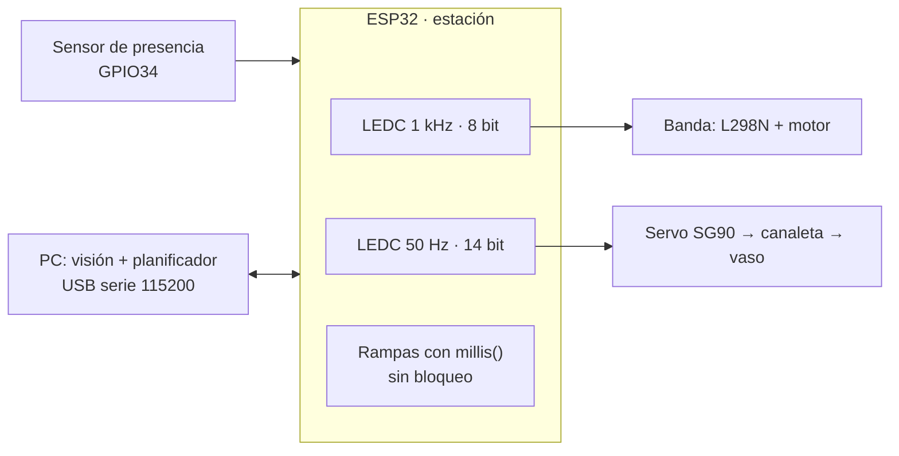

# Análisis por etapas: mecánico, eléctrico y de software

> Los cálculos de autonomía, consumo, caudal y visión están en [calculos.md](calculos.md).

Objetivo del proyecto: *desarrollar de manera funcional el sistema contador de monedas con su transporte y embalaje,
seguido de su sistema de recolección y direccionamiento a la meta final.*

Cuatro etapas, cada una analizada en los tres niveles. Las cifras salen del propio repositorio (`config.py`,
`cad/parametros.py`, `pista.py`); lo que viene de hojas de datos típicas se marca **(típico)** y debe verificarse con
tus componentes reales. Lo que no se ha medido en el montaje físico se marca **(sin medir)**.

| Etapa | Qué resuelve | Dónde vive |
|---|---|---|
| 1. Conteo e identificación | Detectar la moneda, medir, clasificar en 9 clases, contar, pesar y sumar valor | `vision.py`, `clases.py`, `estado.py`, cámara del celular |
| 2. Transporte | Llevar la moneda una por una bajo la cámara y hasta el borde de la banda | banda + `tolva_entrada`, ESP32 + L298N |
| 3. Embalaje | Dejar cada moneda en el vaso de su denominación | canaleta + servo SG90, 5 vasos |
| 4. Recolección y meta | Remolcar el vaso pedido por el chatbot hasta la meta, esquivando 3 obstáculos | carro, BLE, `pista.py`, chatbot, tablero |

## Etapa 1 · Conteo e identificación

**Mecánico.** El celular queda sobre la banda mirando hacia abajo (poste Ø22 + bandeja, altura de lente ≈ 280 mm sobre la
banda). La banda negra y texturizada confunde la detección: se cubre con cartulina lisa y mate. El **embudo de entrada**
(`tolva_entrada`) deja una luz de 4 mm bajo un puente, así que pasa una moneda por vez y no hay monedas
solapadas que la visión no pueda separar. El soporte del sensor IR deja el módulo 38 mm sobre la banda.

**Eléctrico.** Sensor de presencia (LM393) → GPIO34 del ESP32 (solo entrada, activo en bajo); el celular se alimenta
aparte y envía el video por WiFi. No hay potencia en esta etapa: lo crítico es la **tierra común** y que el sensor no se
dispare con luz ambiente **(sin medir)**.

**Software.** Pipeline de `vision.py`: fondo de banda vacía → resta → Hough → diámetro en mm (px × mm/px calibrado) →
color dorado/plateado → clase. Los 9 tipos se reparten en 5 denominaciones (`tipos.py`); `estado.py` cuenta, suma peso
(`masa_g` por tipo; máx. 7,6 g) y valor, y publica `estado.json`. Riesgo principal: **$100 antigua vs $500 antigua**
(2,4 % de diferencia de diámetro) y $200 vs $500; la prueba sintética acierta ≈98 % con ±0,3 mm de error, con monedas
reales hay que validarlo.

**Papel del ESP32.** Entrega el evento de presencia (`P1/P0`) por serie y es quien recibe la orden de servo; el PC no
tiene que generar PWM ni temporizar nada en tiempo real.

## Etapa 2 · Transporte

**Mecánico.** Banda de 160 mm de ancho, 660 mm de largo **(supuesto: 3 módulos de 220)** y superficie a 80 mm de la mesa.
A `V_BANDA_MM_S = 20 mm/s`, una moneda tarda 33 s en recorrerla y 15 s desde la línea de lectura hasta el borde
(`DIST_LINEA_A_BORDE_MM = 300`). Es lento a propósito: da tiempo de leer y de mover el servo, y la moneda sale sin
rebotar. Consecuencia: con monedas separadas ≥ 40 mm el caudal máximo es ≈ 0,5 moneda/s.

**Eléctrico.** Motorreductor DC con **L298N** (ENA = PWM, IN1/IN2 = sentido). El L298N cae ≈ 2 V **(típico)**, por eso con
5 V el motor recibe ≈ 3 V y hace falta `PWM_MIN = 90/255` para vencer la fricción de arranque. Alimentación del motor
separada de la lógica del ESP32, con **GND común**. Dimensionar la fuente ≥ 2 A **(típico)**.

**Software.** `B <0-100>` fija el porcentaje; el firmware **sube y baja el PWM en rampa** (`PASO_RAMPA_MS`) para no
patinar la moneda y sin bloquear el bucle. `SENTIDO_INVERTIDO` corrige el cableado. El PC conoce `V_BANDA_MM_S` y
calcula cuándo llegará cada moneda al borde.

**Papel del ESP32.** Genera el PWM de la banda con **LEDC por hardware** (1 kHz, 8 bits) sin ocupar CPU, y mantiene la
rampa corriendo mientras atiende la serie.

## Etapa 3 · Embalaje (clasificación en vasos)

**Mecánico.** 5 vasos Ø42 × 45 mm (interior Ø36 > moneda mayor 26 mm + 8 mm de holgura) en un arco de R = 110 mm
alrededor del pivote del servo, en los ángulos 20/45/90/135/160°. Cada vaso guarda la moneda **actual y la antigua** de
su valor. Capacidad ≈ 24 monedas de $1000 hasta ≈ 56 de $50 (espesor ≈ 2 mm, 60 % de aprovechamiento) → ≤ 212 g; ver [calculos.md](calculos.md). La canaleta baja de 78 a 54 mm:
**pendiente 14°**, poca para deslizar desde reposo (una moneda sobre plástico pide ≈ 17–22°), así que depende del
impulso de la banda y de un canal liso **(sin medir)**. Validado en malla: la canaleta no choca con vasos ni torre en
ningún ángulo (`cad/generar_cad.py --check`). Torque: un SG90 da ≈ 1,8 kg·cm **(típico)** y la canaleta (≈ 18 g, giro
horizontal) necesita una fracción: sobra torque, el límite es la velocidad (≈ 0,1 s/60° **(típico)**).

**Eléctrico.** Servo SG90: señal → GPIO23, +5 V y GND de la fuente (no del pin 3V3 del ESP32). Consumo en movimiento
≈ 100–250 mA y hasta ≈ 650 mA al bloquearse **(típico)**; por eso la alimentación es de cargador y no del USB del PC.
Un condensador de 470–1000 µF junto al servo evita reinicios del ESP32 por caídas de tensión **(recomendado, sin medir)**.

**Software.** `Planificador` convierte la clase en vaso (`CUBICULO_DE_VALOR`) y manda `C <k>`; las monedas no
reconocidas van a `ANGULO_RECHAZO`. Modo `SERVO_INMEDIATO` (mueve al cruzar la línea) o sincronizado por tiempo. El
firmware mueve el servo **con rampa de ángulo**, sin `delay`, así que una nueva orden nunca espera a la anterior.
Los ángulos se calibran con `G` y `S`, y se copian a `ANGULOS[]` y a `cad/parametros.py` (hay una prueba que los compara).

**Papel del ESP32.** Es el que une las dos salidas físicas (banda y servo) con tiempos independientes: dos canales LEDC
con **timers distintos** (1 kHz y 50 Hz) y un bucle cooperativo `millis()`. Con un solo microcontrolador simple habría
que elegir entre banda suave o servo preciso.

## Etapa 4 · Recolección y direccionamiento a la meta

**Mecánico.** El carro (170 × 240 mm) retrocede, engancha la **oreja** del vaso con un pasador Ø5,4 y lo remolca. La
fuerza de arrastre es mínima: vaso + monedas ≈ 0,23 kg con μ ≈ 0,4 → ≈ 0,9 N **(estimado)**. La pista tiene
3 tramos rectos (91/66/93 cm), 2 retornos en U de Ø32 cm y 3 termos Ø90 mm; el recorrido plan mide ≈ 3,5 m en
≈ 17,8 s (≈ 200 mm/s) con `V_AVANCE = 250` y `T_GIRO90 = 450` **provisionales**. El carro tiende a irse a la
derecha: se compensa con avance controlado (`F1000` + `L40`) y con el factor de ruedas `K`.

**Eléctrico.** Arduino UNO + shield LAFVIN (puente H) + módulo BLE JDY-16 (3,3 V; UNO a 5 V → divisor de tensión en RX
del módulo) + sensor de distancia frontal. Los motores van de las pilas del shield; el UNO y el BLE comparten GND.
Tensión de pilas baja = mismo comando, distinta velocidad: recalibrar `V_AVANCE` cuando cambien las pilas **(sin medir)**.

**Software.** `pista.py` genera la ruta (≤ 120 tramos `F/B/L/R/S` + ms) y `hardware.CarroBLE` la envía por BLE en
trozos de 20 bytes (`C`, `A…`, `E`). El `Despachador` verifica que el vaso no esté vacío y que el carro esté libre, espera
`meta` y marca el vaso como despachado. Chatbot y tablero escriben el mismo `comando.json`. El firmware se detiene ante
obstáculos solo en modo manual; en ruta usa `N<cm>` bajo para poder esquivar.

**Papel del ESP32.** Aquí hay una **limitación honesta**: el carro usa **Arduino UNO**, no ESP32. Funciona, pero necesita el
módulo JDY-16 y no puede enviar telemetría continua. Migrarlo a ESP32 daría BLE integrado (sin JDY-16 ni divisor), telemetría
`odometría + distancia` hacia `estado.json` y control de ruedas con PWM por hardware. **No está hecho**; es la mejora de mayor
valor para la etapa 4.

## Importancia del ESP32 en el sistema

| Característica | ESP32 (estación) | Arduino UNO (carro) | Qué aporta al proyecto |
|---|---|---|---|
| Reloj / memoria | 240 MHz dual-core / ≈ 520 kB SRAM | 16 MHz / 2 kB | Atiende serie, rampas y sensor a la vez |
| PWM | LEDC por hardware, frecuencia y resolución por canal | 6 canales de 8 bits, timers compartidos | Banda a 1 kHz y servo a 50 Hz **14 bits** sin interferirse |
| Lógica | 3,3 V | 5 V | Hay que cuidar los niveles con el JDY-16 (3,3 V) |
| Comunicación | USB serie + WiFi + BLE integrados | Solo serie; BLE por módulo externo | Camino a eliminar el JDY-16 y usar ESP-NOW/WiFi |
| ADC | 12 bits | 10 bits | Margen para sensores analógicos futuros |

En resumen: el ESP32 es el **puente entre el software y el mundo físico** de las etapas 1–3 (temporiza, mueve y lee en
paralelo), y su sustitución del UNO en la etapa 4 sería la evolución natural.

## Matriz de cumplimiento

| Requisito | Evidencia en el repositorio | Estado |
|---|---|---|
| Sistema contador de monedas funcional | `monedas/vision.py`, `estado.py`; `python -m monedas --demo` | Demo funciona; visión calibrada en banco, **sin validar con las 9 clases reales** |
| Transporte | Banda + L298N + rampa PWM (`estacion_esp32.ino`), `tolva_entrada.stl` | Firmware movió banda y servo; la banda **aún no arrastra bien** |
| Embalaje | 5 vasos, canaleta, torre, placa (`cad/`), `Planificador` | Piezas validadas en malla, **sin imprimir** |
| Recolección y direccionamiento a la meta | `pista.py`, `CarroBLE`, `Despachador`, chatbot, tablero | Probado en simulación; carro real con deriva por afinar |
| Análisis mecánico / eléctrico / software por etapa | Este documento + `docs/cad.md`, `docs/arquitectura.md`, `docs/pista.md` | Entregado; valores **(sin medir)** pendientes |
| Importancia del ESP32 | Sección anterior; `firmware/estacion_esp32/` | Documentada; el carro sigue en UNO |
