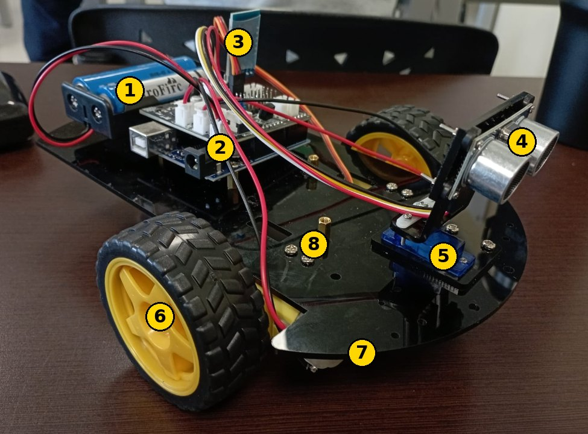
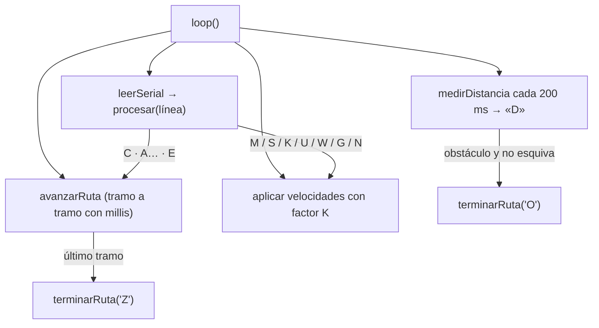

# El carro: estructura y placa Arduino

| N.º | Parte | Observaciones |
|---|---|---|
| 1 | Portapilas con **2 celdas 18650** | Atrás y arriba: pesa sobre las ruedas motrices y da tracción al remolcar |
| 2 | **Arduino UNO + shield LAFVIN** | Cerebro y puente H de los motores (USB-B y jack de la UNO visibles) |
| 3 | Módulo **BLE JDY-16** | Comunicación con el PC y el panel web |
| 4 | Sensor de distancia ultrasónico | Detecta los termos (en ruta usa `N<cm>` bajo para poder esquivar) |
| 5 | **Servo azul (SG90)** del sensor | Centrado en 90° (`SERVO_CENTRO`) |
| 6 | Motorreductor **TT amarillo** + rueda | Tracción diferencial (dos ruedas motrices) |
| 7 | Chasis acrílico negro de dos niveles | Con una rueda loca; el punto de salida de la pista es el **centro** del carro |
| 8 | Separadores de latón | Unen los dos niveles |

## Estructura mecánica

* **Tracción diferencial** de dos ruedas con rueda loca: gira en el sitio (tramos `L` y `R`) y por eso la ruta se compone de «avanzar / girar / avanzar».
* **Reparto de masa:** baterías atrás y electrónica al centro dejan el peso sobre el eje motriz. Es lo que le permite arrastrar el vaso (≈ 0,9 N, ver [calculos.md](calculos.md)) sin patinar; el sensor delantero casi no pesa.
* **Remolque:** el pasador `enganche_carro` se fija atrás y entra en la oreja del vaso (`cad/`). Al retroceder (`B800`) el pasador encaja y al avanzar el vaso sigue al carro.
* **Dimensiones usadas por la ruta:** 170 mm de ancho (de rueda a rueda) × 240 mm de largo; el margen lateral en el carril de 220 mm es de 25 mm por lado, por eso el avance controlado corrige constantemente.
* **Deriva:** con motores TT las dos ruedas nunca giran igual. Se compensa con el factor `K` del firmware (EEPROM) y la corrección `L` de la ruta.

## Por qué la placa Arduino (y sus límites)

| Recurso del ATmega328P (UNO) | Cómo lo usa el firmware | Límite que hay que conocer |
|---|---|---|
| 16 MHz, 5 V | Bucle sin `delay`: parser de órdenes + ejecución de tramos con `millis()` | Sin WiFi ni BLE propios |
| 2 kB de SRAM | Ruta `ruta[120]` (3 bytes por tramo = **360 B**) + búfer de línea de 80 B ≈ **440 B** | Subir `MAX_TRAMOS` no escala: 120 tramos ya ocupan ≈ 18 % de la SRAM **(estimado, compílalo para confirmar)** |
| 1 kB de EEPROM | Guarda el factor de ruedas `K` (3 bytes) | Hasta ≈ 100 000 escrituras: por eso usa `EEPROM.update` |
| 1 UART (pines 0/1) | Compartido entre el USB y el JDY-16 | **Retira el JDY-16 para subir el código**; no se puede depurar por USB con el BLE conectado |
| Timer0 en D5/D6 | PWM de los motores (≈ 976 Hz) | Cambiar su frecuencia afectaría `millis()` |
| Timer1 (librería `Servo`) | Servo del sensor en D10 | Anula el PWM en D9/D10: por eso los motores van en D5/D6 |
| `pulseIn` con espera de 20 ms | Distancia cada 200 ms | Si el sensor no recibe eco, el bucle se bloquea hasta 20 ms (≈ 10 % del tiempo) |

### Arquitectura del firmware del carro

El PC conoce el resultado de cada ruta por la respuesta de una letra (`Z` completa, `O` obstáculo, `X` cancelada).

## ¿Y si el carro pasara a ESP32?

| | Arduino UNO (hoy) | ESP32 (mejora) |
|---|---|---|
| Comunicación | JDY-16 + divisor de tensión + 1 UART compartida | BLE/WiFi integrados; el USB queda libre para depurar |
| Memoria | 2 kB: ruta limitada a 120 tramos | ≈ 520 kB: rutas largas y registro de telemetría |
| PWM | 2 pines con Timer0 | LEDC por canal, frecuencia propia por motor |
| Datos al tablero | Solo la respuesta de la ruta | Odometría, batería y distancia en tiempo real hacia `estado.json` |
| Cuidado | — | Lógica de 3,3 V (el eco del HC-SR04 es de 5 V: divisor) y consumo de WiFi (≈ 240 mA) |

Sería la mejora de mayor valor para la etapa 4 y completaría la idea de que el ESP32 es la placa de todo el sistema. **No está hecha**: el firmware actual es para UNO.
