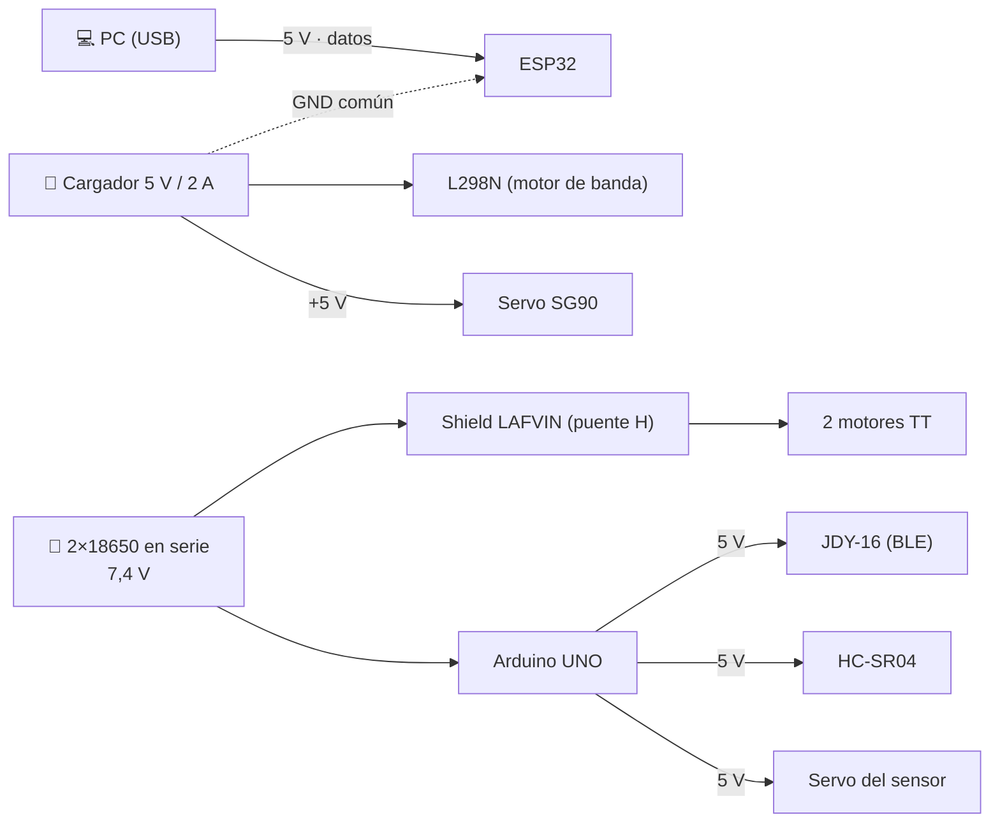
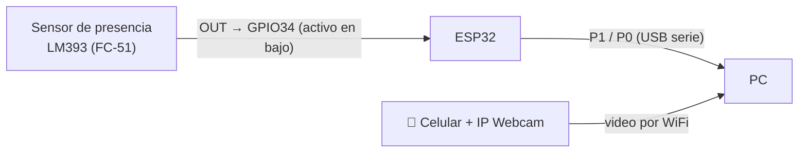
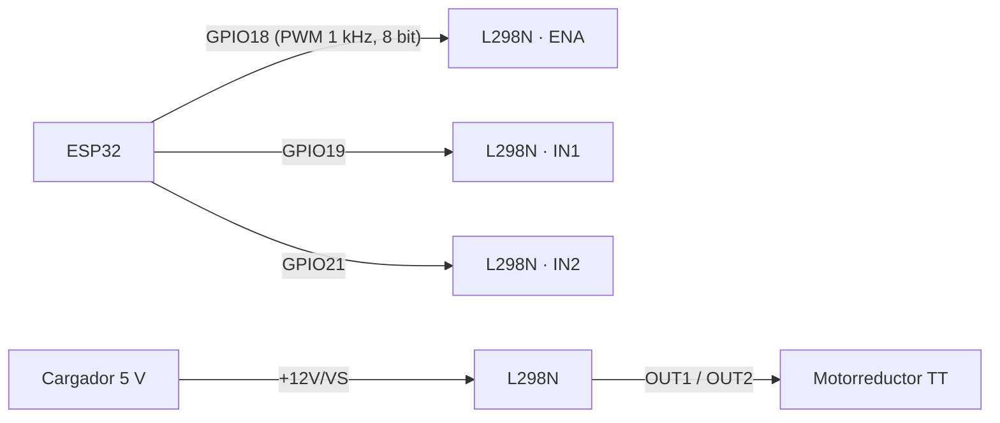
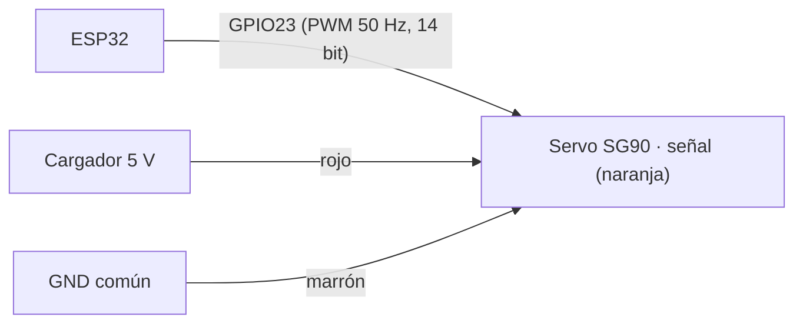
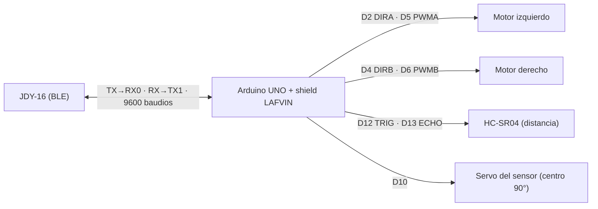

# Diseño eléctrico por etapas

Todo el cableado sale de los `.ino` (`firmware/`). Lo marcado **(típico)** viene de hojas de datos genéricas y debe
verificarse con tus componentes; los consumos están calculados en [calculos.md](calculos.md).

## Distribución de energía

Reglas que evitan la mayoría de fallos:
* **GND común** entre ESP32, L298N, servo y cargador. Sin eso el PWM y el servo se comportan al azar.
* El servo **no** se alimenta del pin 3V3 ni del USB del PC (puede pedir 650 mA al bloquearse **(típico)**).
* Condensador de 470–1000 µF entre +5 V y GND junto al servo.
* El jumper de ENA del L298N va **quitado** (el PWM entra por ENA).
* El JDY-16 comparte los pines 0/1 del UNO con el USB: **retíralo antes de subir el código**.

---

## Etapa 1 · Conteo e identificación

| Señal | Pin ESP32 | Notas |
|---|---|---|
| Presencia (OUT del LM393) | **GPIO34** | Solo entrada (sin pull-up interno); `ACTIVO_EN_BAJO = true`; antirrebote `DEBOUNCE_MS` |
| VCC / GND del sensor | 3V3 / GND | Ajustar el potenciómetro hasta que el LED conmute con una moneda y no con la luz ambiente |

El celular se alimenta aparte. Lo crítico de esta etapa es mecánico y de iluminación (fondo mate y luz pareja), no eléctrico.

## Etapa 2 · Transporte (banda)

| Señal | Pin ESP32 | Función |
|---|---|---|
| ENA | **GPIO18** | PWM de velocidad (LEDC 1 kHz, 8 bits) |
| IN1 / IN2 | **GPIO19 / GPIO21** | Sentido (`SENTIDO_INVERTIDO` si corre al revés) |

El L298N cae ≈ 2 V **(típico)**: con 5 V el motor recibe ≈ 3 V, por eso existe `PWM_MIN = 90` (duty mínimo para arrancar).

## Etapa 3 · Embalaje (canaleta con servo)

| Señal | Pin | Detalle |
|---|---|---|
| Señal del servo | **GPIO23** | Pulso 0,5–2,4 ms a 50 Hz con 14 bits de resolución → ≈ 0,011°/paso |
| Alimentación | +5 V del cargador | Con condensador 470–1000 µF |
| Ángulos | `ANGULOS[] = {20, 45, 90, 135, 160}` | Un vaso por ángulo; se calibran con `G` y `S` |

Los canales LEDC de banda y servo usan **timers distintos** (1 kHz y 50 Hz), por eso no se interfieren.

## Etapa 4 · Recolección y meta (carro)

| Señal | Pin UNO | Función |
|---|---|---|
| `IZQ_DIR` / `IZQ_PWM` | D2 / D5 | Motor izquierdo (canal A del shield) |
| `DER_DIR` / `DER_PWM` | D4 / D6 | Motor derecho (canal B) |
| `TRIG` / `ECHO` | D12 / D13 | Distancia frontal (HC-SR04) |
| `SERVO_PIN` | D10 | Servo del sensor (`SERVO_CENTRO = 90`) |
| BLE JDY-16 | D0 / D1 | Serie a 9600 baudios (`BAUDIOS_BT`) |

El módulo JDY-16 trabaja a 3,3 V en las líneas de datos: pon un divisor de tensión (1 kΩ / 2 kΩ) entre el TX del UNO y el RX del módulo.
El shield alimenta los motores desde las pilas y el puente H cae ≈ 1,4 V **(típico)**.
`FACTOR_IZQ_INICIAL` y `FACTOR_DER_INICIAL` (100 y 100) compensan la diferencia entre ruedas y se guardan en EEPROM con `K<izq>,<der>`.

## Lista de comprobación antes de energizar

- [ ] Todas las tierras unidas y sin cortos entre +5 V y GND.
- [ ] Polaridad de las celdas 18650 y del cargador revisada con el multímetro.
- [ ] Jumper de ENA del L298N retirado; JDY-16 desconectado al subir código.
- [ ] Servo en 90° (`H`) **antes** de montar la canaleta en el horn.
- [ ] Corriente medida en marcha (carro y estación) y comparada con [calculos.md](calculos.md).
