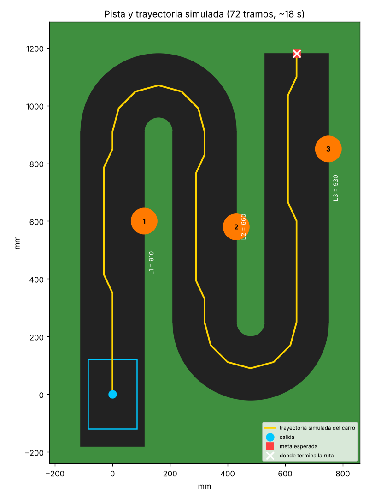

# La pista y la ruta del carro

Tres tramos rectos (izquierdo 91 cm, central 66 cm, derecho 93 cm; carril de 22 cm) unidos por dos retornos en U de
32 cm de diámetro. Tres termos de Ø90 mm son los obstáculos. `monedas/pista.py` calcula la ruta del carro:

* **Avance controlado:** el carro se desvía hacia la derecha, así que avanza 1 s (`F1000`) y rectifica a la izquierda
  (`L40`). Sube `CORRECCION_IZQ_MS` si todavía se va a la derecha.
* **Retornos en U:** semicírculo en pasos de 30° (avanzar un poco, girar, avanzar…).
* **Esquives:** giro de `ANGULO_ESQUIVE`, avance lateral y regreso, con `MARGEN_LONG` delante y detrás del termo.
* Salida: `docs/img/pista_ordenes.txt` con las órdenes `C`, `A…` y `E` para el Bluetooth (líneas de ≤ 60 caracteres).

Valores **medidos**: largos de los tramos rectos y diámetro del termo. **Provisionales:** separación entre ejes (320 mm),
`V_AVANCE=250 mm/s` y `T_GIRO90=450 ms`. `python -m monedas.pista` avisa si un obstáculo no cabe en su tramo.
El visor 3D reproduce esta misma ruta (`pista.simular_poses`).
