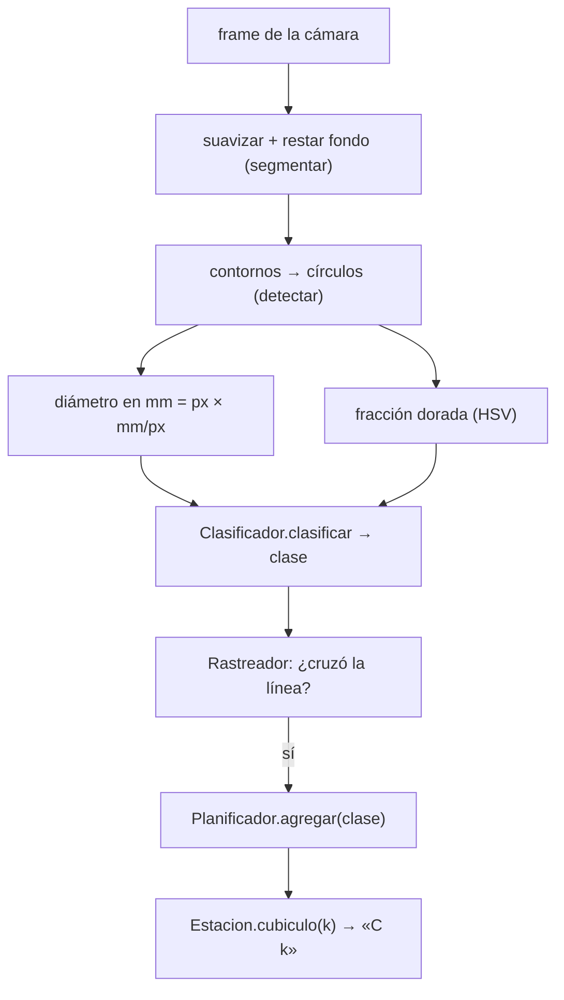
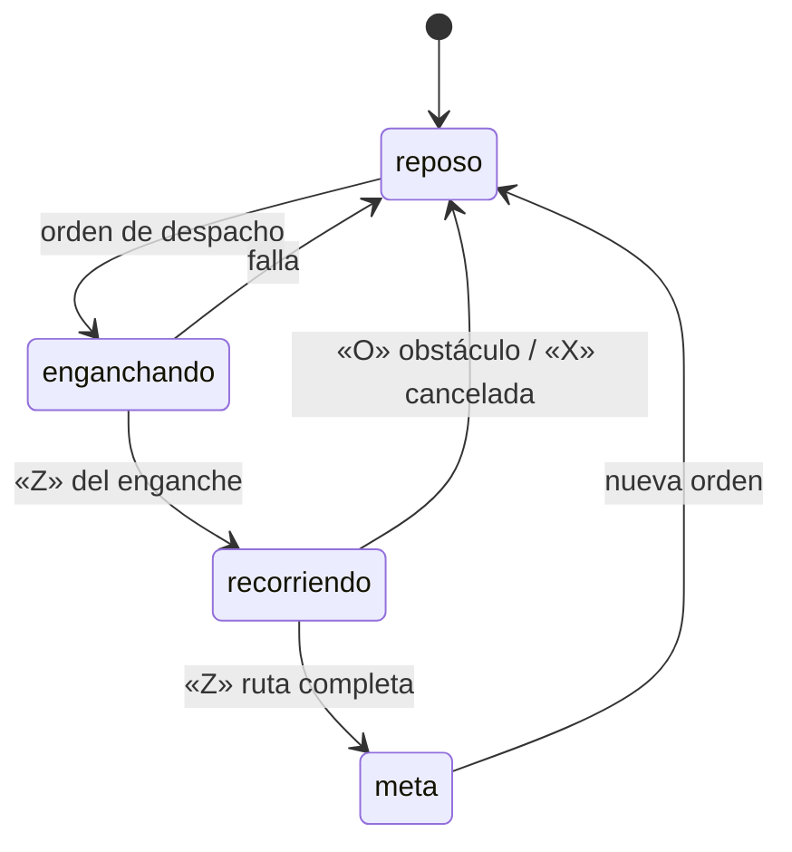

# Software y código por etapas

Mapa de dónde vive cada pieza y los fragmentos clave **copiados del código real**.

| Etapa | Archivos | Qué hace |
|---|---|---|
| 1 · Conteo | `monedas/vision.py`, `clases.py`, `tipos.py`, `estado.py` | Detecta, mide y clasifica; cuenta, pesa y suma valor |
| 2 · Transporte | `firmware/estacion_esp32/estacion_esp32.ino` | Banda con rampa de PWM |
| 3 · Embalaje | `monedas/planificador.py` (`Planificador`), `hardware.py`, el `.ino` de la estación | Servo justo a tiempo hacia el vaso |
| 4 · Meta | `monedas/pista.py`, `planificador.py` (`Despachador`), `hardware.py` (`CarroBLE`), `firmware/carro_monedas/`, `chatbot.py`, `dashboard.py` | Ruta, remolque y narración |



## Etapa 1 · Visión

`vision.segmentar` (resta del fondo con la banda vacía o, sin fondo, estimación del papel):

```python
dif = cv2.absdiff(suave, fondo).max(axis=2)
_, mascara = cv2.threshold(dif, umbral, 255, cv2.THRESH_BINARY)
...
nucleo = cv2.getStructuringElement(cv2.MORPH_ELLIPSE, (5, 5))
mascara = cv2.morphologyEx(mascara, cv2.MORPH_OPEN, nucleo, iterations=1)
mascara = cv2.morphologyEx(mascara, cv2.MORPH_CLOSE, nucleo, iterations=2)
```

`Clasificador.clasificar` (tamaño y color ponderados; solo se acepta si el tamaño está dentro de `TOL_TAMANO`):

```python
for v, ref in refs.items():
    err_tam = abs(d - ref["d"]) / ref["d"]
    if err_tam > TOL_TAMANO:
        continue
    err_color = abs(oro - ref["oro"])
    puntaje = err_tam / TOL_TAMANO + PESO_COLOR * err_color
    if puntaje < mejor_puntaje:
        mejor, mejor_puntaje = v, puntaje
```

## Etapa 2 · Banda (ESP32)

`ponerBanda` fija el objetivo y `actualizarBanda` sube o baja el PWM de a un paso (rampa sin `delay`):

```cpp
void ponerBanda(int pct) {
  bandaPct = constrain(pct, 0, 100);
  if (bandaPct == 0) dutyObjetivo = 0;
  else dutyObjetivo = map(bandaPct, 1, 100, PWM_MIN, 255);
}

void actualizarBanda() {
  if (dutyBanda == dutyObjetivo || millis() - tRampa < PASO_RAMPA_MS) return;
  tRampa = millis();
  dutyBanda += (dutyObjetivo > dutyBanda) ? 1 : -1;
  escribirBanda(dutyBanda);
}
```

## Etapa 3 · Servo y planificador

Firmware: pulso SG90 de 0,5–2,4 ms con 14 bits y movimiento por rampa de ángulo.

```cpp
void escribirServo(int grados) {
  grados = constrain(grados, 0, 180);
  long pulso_us = 500L + (long)grados * (2400L - 500L) / 180L;   // SG90: 0.5-2.4 ms
  int duty = (int)(pulso_us * 16383L / 20000L);
  ledcWrite(PIN_SERVO, duty);
}
void actualizarServo() {
  if (servoActual == servoObjetivo || millis() - tServo < PASO_SERVO_MS) return;
  tServo = millis();
  int d = servoObjetivo - servoActual;
  servoActual += (abs(d) < PASO_GRADOS) ? d : (d > 0 ? PASO_GRADOS : -PASO_GRADOS);
  escribirServo(servoActual);
}
```

PC: `Planificador` gira la canaleta justo antes de que llegue la moneda y cuenta cuando cae.

```python
k = cfg.cubiculo_de_valor(mc.valor_de(clave))            # vaso de esa denominación (None = rechazo)
self._esperar_hasta(llegada - cfg.TIEMPO_SERVO_S)
if k is None:
    self.estacion.angulo(cfg.ANGULO_RECHAZO)
else:
    self.estacion.cubiculo(k)                             # envía «C k» por serie
self._esperar_hasta(max(llegada, time.time()) + cfg.TIEMPO_CAIDA_S)
self.estado.moneda_llego(clave, k)
```

## Etapa 4 · Ruta, carro y despacho

`pista.avance` (avance controlado) y `pista.retorno` (semicírculo por pasos):

```python
def avance(mm):
    ms = ms_dist(mm)
    toks = []
    for _ in range(ms // PASO_RECTO_MS):
        toks += [("F", PASO_RECTO_MS), ("L", CORRECCION_IZQ_MS)]    # 1 s adelante + rectificar a la izquierda
    ...

def retorno(giro, separacion):
    n = max(1, int(round(180.0 / PASO_GIRO_GRADOS)))
    paso = 180.0 / n
    lado = separacion * math.sin(math.radians(paso / 2))           # cuerda = 2R·sin(paso/2)
    toks = [(giro, ms_giro(paso / 2))]
    for i in range(n):
        toks.append(("F", ms_dist(lado)))
        toks.append((giro, ms_giro(paso if i < n - 1 else paso / 2)))
    return toks
```

Firmware del carro: `cargarRuta` valida y guarda los tramos; `aplicarTramo` los convierte en velocidades de rueda.

```cpp
void aplicarTramo(byte i) {
  switch (ruta[i].c) {
    case 'F': velIzq = velAdelante;  velDer = velAdelante;  break;
    case 'B': velIzq = -velReversa;  velDer = -velReversa;  break;
    case 'L': velIzq = -velGiro;     velDer = velGiro;      break;   // gira a la izquierda
    case 'R': velIzq = velGiro;      velDer = -velGiro;     break;   // gira a la derecha
    default:  velIzq = 0;            velDer = 0;
  }
  finTramo = millis() + ruta[i].ms;
}
```

`Despachador.despachar` (orden completa del chatbot):

```python
k = cfg.CUBICULO_DE_VALOR[valor]                          # actual y antigua comparten vaso
if est.cantidad_vaso(valor) == 0 and not cfg.DESPACHAR_VACIOS:
    est.evento("El vaso de ... esta vacio: no se despacha."); return
r = self.carro.ejecutar_ruta(cfg.RUTA_ENGANCHE[k])        # retrocede y engancha
if r != "Z": self._fallo(tipo, f"enganche: {r}"); return
r = self.carro.ejecutar_ruta(cfg.ruta_pista())            # recorre la pista
if r == "Z":
    est.carro["estado"] = "meta"
    est.marcar_despachado(valor)
```

## Estados del carro



## Calidad del código

* `pytest` (81 pruebas): protocolo del carro, pista, planificador y despachador con hardware simulado, chatbot, tablero con `AppTest`, visión sobre video sintético, CAD, cálculos y **consistencia firmware↔software** (ángulos del servo, `MAX_TRAMOS`, tokens de ruta, factor de ruedas).
* `ruff` en CI; el demo (`python -m monedas --demo`) corre sin ventana en CI.
