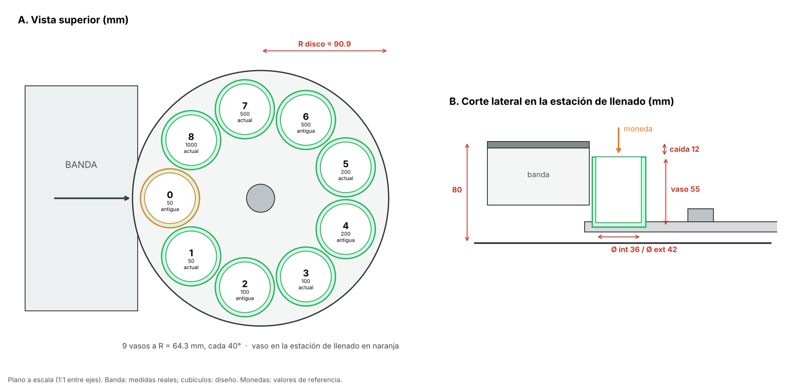

## Cubículos de clasificación (final de la banda)

Al final de la banda hay **9 cubículos, uno por tipo de moneda**. La moneda sale por el extremo de la banda, cae
12 mm y queda dentro del vaso que está en la estación de llenado; el carrusel gira 40° por tipo para ponerlo ahí.

| Pieza | Cantidad | Medidas (mm) | Archivo |
|---|---|---|---|
| Vaso (cubículo) | 9 | Ø int 36 · Ø ext 42 · alto 55 · pared 3 · fondo 3 | `cad/vaso.stl` |
| Disco portavasos | 1 | Ø 182 · espesor 8 · 9 alojamientos Ø 43,2 a R = 64,3 · cubo para eje de 5 mm | `cad/disco_portavasos.stl` |
| Plano 2D acotado | 1 | vista superior y corte | `cad/cubiculos.dxf` |

- **Por qué estas medidas:** la moneda más grande ($1000, 26 mm) cabe con holgura y las monedas se apilan casi planas.
  El vaso es una pieza **separada** del disco para que luego el carro pueda enganchar el cubículo despachado.
- **Alturas (desde la mesa):** superficie de la banda 80 · borde del vaso 68 · cara del disco 17 · base del disco 9.
  La base queda a solo 9 mm de la mesa: el motor del carrusel va **debajo**, por una ventana en la mesa o sobre una
  base elevada.
- **Qué cubículo recibe cada moneda:** el vaso `k` es el tipo `k` de `config.TIPOS` (0 = $50 antigua, ..., 8 = $1000 actual).
  La cámara entrega el tipo, el sistema calcula el giro del disco con `yaw_disco_para_llenar(k)` (`config_fisico.py`)
  y el motor paso a paso lo ejecuta: 40° por índice.
- **Impresión 3D:** el disco necesita una cama de al menos 190 × 190 mm; si la tuya es menor, se puede partir en dos mitades.
  Los vasos se imprimen de pie, sin soportes.

**Prueba en PyBullet** (`python tests/test_cubiculos_reales.py`): usa los STL reales y lanza cada uno de los 9 tipos
desde el extremo de la banda a 100, 150 y 250 mm/s, con la moneda desviada ±6 mm hacia un lado: **81/81 monedas
terminan en su cubículo.** A 700 mm/s la moneda sale disparada y ya falla, así que la banda real debe ir despacio.
Esta prueba valida la geometría y el sentido de giro; **no** reemplaza probar con monedas y banda reales
(velocidad real, rebote y fricción de la cinta).

Para regenerar piezas y planos tras cambiar medidas en `config_fisico.py`: `python cad/generar_cubiculos.py`.
Las medidas de la banda son las tomadas por el autor; las de los cubículos son de diseño; las monedas son valores de referencia.
