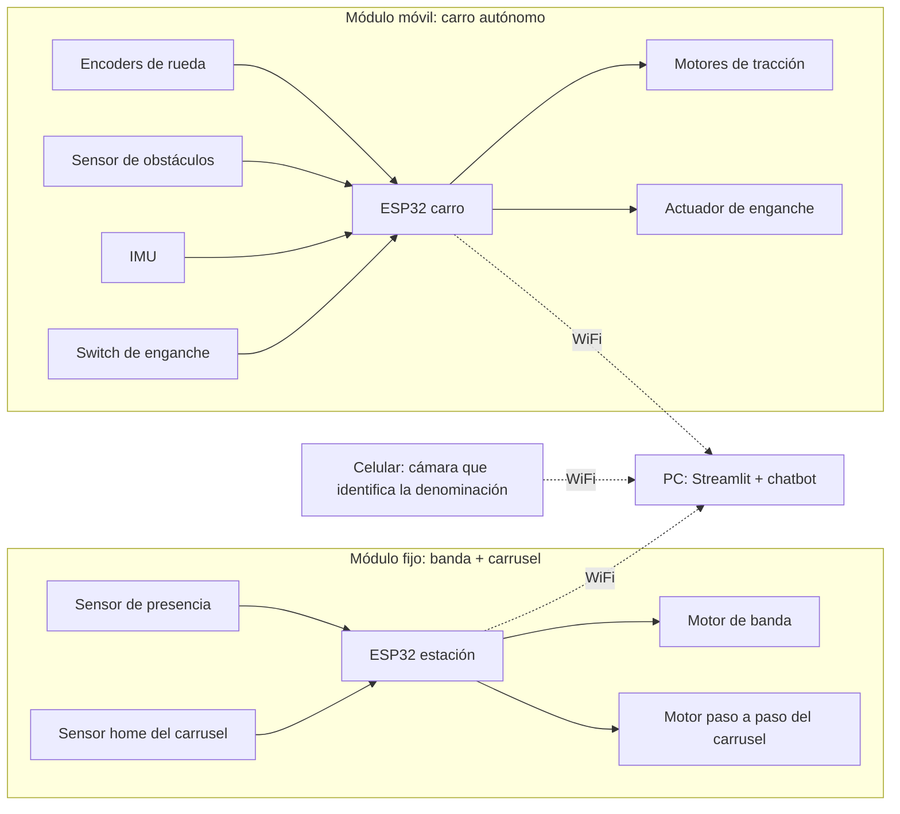

# Sistema logístico de monedas inteligentes

Proyecto de curso — Ingeniería Mecatrónica, Universidad Militar Nueva Granada (UMNG).
Autor: Kevin · Curso / semestre: _[completar]_ · Docente: _[completar]_

Sistema que recibe monedas colombianas, las identifica con visión por computador, las clasifica en un
carrusel de 9 cubículos y despacha el cubículo elegido con un carro autónomo que lo remolca por una pista
con curvas y obstáculos hasta la meta. Un chatbot narra el proceso y recibe las órdenes de despacho.

> **Estado del repositorio: avance parcial.** La simulación física completa está funcionando y validada;
> el módulo de visión y la prueba de sensores están listos para pruebas de banco; el tablero Streamlit, los
> planos CAD y el firmware de la ESP32 están pendientes. El detalle está en [Estado del avance](#estado-del-avance).

---

## Qué hace el sistema

1. **Entrada y banda recta.** La moneda entra a una banda transportadora en línea recta.
2. **Sensor de presencia + cámara.** Al pasar por el sensor, la cámara del celular identifica la
   denominación entre 9 tipos.
3. **Carrusel de 9 cubículos.** Gira hasta alinear el cubículo del tipo detectado con el punto de caída.
   Hay un cubículo por cada tipo: $50, $100, $200 y $500 (versión antigua y actual) y $1000 (solo actual).
4. **Despacho por orden del chatbot.** El carrusel lleva el cubículo al lado del carro, el carro se engancha
   como remolque (no se sube a una bandeja) y sale a la pista.
5. **Conducción autónoma.** El carro sigue la pista (mínimo dos curvas) y esquiva tres obstáculos usando un
   sensor de distancia en abanico, hasta llegar a la meta.
6. **Monitoreo.** El sistema publica cantidad, peso y valor total de monedas, y la posición del carro,
   para el tablero en tiempo real y para el chatbot.

## Vista de la simulación

Imágenes generadas con el propio modelo (PyBullet).


*Banda recta con el sensor de presencia, carrusel de 9 cubículos con monedas y carro en la estación de despacho.*


*El carro lleva el cubículo enganchado por la pista; los bloques rojos son los 3 obstáculos y al final está la meta.*

## Arquitectura



Línea continua: cableado directo a cada ESP32. Línea punteada: enlace inalámbrico.
Cada módulo tiene su propia ESP32; el PC coordina la secuencia (qué cubículo despachar, cuándo enganchar y salir).

### Sensores previstos

| Módulo | Sensor | Función |
|---|---|---|
| Banda | Inductivo de proximidad (provisional: módulo IR LM393) | Detectar la llegada de una moneda y disparar la cámara |
| Identificación | Cámara de celular | Clasificar la denominación (no es un sensor de la ESP32) |
| Carrusel | Microswitch o fotointerruptor | Referencia de origen del motor paso a paso |
| Carro | Ultrasónico HC-SR04 o ToF VL53L0X | Detectar y esquivar los 3 obstáculos |
| Carro | Encoders de rueda | Odometría y control de velocidad |
| Carro | IMU MPU6050 (opcional) | Orientación en las curvas |
| Carro | Microswitch o reed switch | Confirmar el enganche del remolque |
| Opcional | Celda de carga + HX711, sensor de corriente INA219 | Verificación de peso y consumo para el tablero |

## Estado del avance

| Objetivo específico | Estado | Qué hay |
|---|---|---|
| 1. Arquitectura, requerimientos y diagramas de bloques | Avanzado | Diagrama de bloques y selección de sensores (esta sección). Falta la justificación formal de materiales. |
| 2. Diseño mecánico y electrónico (CAD, planos, esquemas) | Pendiente | Solo el modelo URDF de la simulación. Faltan planos CAD del carrusel y la banda, y el esquema eléctrico. |
| 3. Primeros módulos (se acepta simulación en PyBullet) | Avanzado | Simulación completa en PyBullet, módulo de visión con celular y sketch de prueba del sensor IR. |
| 4. Aplicación web/móvil con primeras métricas | Parcial | El contrato `estado.json` / `comando.json` ya está definido y lo usa el chatbot en consola. Falta el tablero en Streamlit y la conexión inalámbrica a la ESP32. |

### Resultados de la simulación

Corrida de verificación (`--sin-gui --rapido --monedas 10 --auto-despachar 500_actual`):

- 10 de 10 monedas terminan dentro del cubículo de su denominación.
- El cubículo despachado llega enganchado al carro.
- El carro detecta los 3 obstáculos y toca 0.
- Tiempo simulado aproximado: 112 s.

### Lo que es real y lo que es simplificado

- **Real en la física:** monedas y cubículos con masa e inercia, carro diferencial con ruedas y ruedas locas,
  conducción autónoma con un sensor de distancia de 19 rayos y desvío de ruta alrededor de cada obstáculo.
- **Simplificado en la simulación:**
  - Banda y carrusel se mueven por posición controlada (cinemática), no por fricción real; arrastran las
    monedas que ya están dentro del cubículo.
  - La cámara simulada lee la denominación que generó el propio código (con una probabilidad de error
    configurable en `CAMARA_PRECISION`).
  - El enganche es una restricción fija; en el sistema físico será un gancho mecánico.
- **Módulo de visión real (`camara_moneda.py`):** recibe el video del celular por WiFi, detecta la moneda con
  transformada de Hough, calibra milímetros por píxel con una moneda de $1000 y clasifica por diámetro y color
  contra los 9 tipos. La lógica de clasificación se comprobó con mediciones sintéticas (98 % de acierto con
  ±0,3 mm de error). **Falta validarlo con monedas reales** y ajustar el umbral de color dorado/plateado.
  La moneda de $500 antigua (21,0 mm) es la más fácil de confundir con la de $100 y la de $200 por tamaño.

### Problemas conocidos

- En un equipo con gráficos integrados AMD y controlador de 2021, la ventana 3D de PyBullet se colgó al
  iniciar (Windows registró "Application Hang"). La simulación sin ventana funciona con normalidad.
  Pendiente: actualizar el controlador de video y volver a probar la vista 3D.
- El módulo IR LM393 es solo un sustituto del sensor inductivo; hay que calibrar su distancia de detección en
  la banda real.

## Estructura del repositorio

| Ruta | Contenido |
|---|---|
| `config.py` | Todos los parámetros: los 9 tipos de moneda, banda, carrusel, carro y pista |
| `generar_urdf.py` | Genera los URDF de banda, entrada, sensor, disco, cubículo y carro en `urdf/` |
| `simulacion.py` | Física completa: banda, identificación, carrusel, remolque y pista con obstáculos |
| `chatbot.py` | Chatbot en consola: narra el estado (con voz opcional) y traduce órdenes de texto en despachos |
| `camara_moneda.py` | Clasificación de monedas con la cámara del celular (OpenCV) |
| `arduino/prueba_sensor_ir/` | Sketch para probar el sensor IR de presencia con el monitor serial |
| `urdf/` | Piezas del modelo generadas por `generar_urdf.py` |
| `tests/` | Pruebas de la clasificación de monedas y de la simulación completa |
| `docs/` | Capturas de la simulación usadas en este README |
| `requirements.txt` | Dependencias de Python |
| `estado.json` | Estado publicado cada 0,25 s por la simulación (se crea al ejecutar) |
| `comando.json` | Orden de despacho que escribe el chatbot y consume la simulación (se crea al ejecutar) |
| `camara_estado.json`, `calibracion.json` | Última denominación detectada y calibración de la cámara (se crean al ejecutar) |

## Cómo ejecutarlo

Requisitos: Python 3.10 o superior.

```bash
pip install -r requirements.txt   # pyttsx3 (voz del chatbot) es opcional
python generar_urdf.py
```

**Simulación sin ventana (verificación rápida):**

```bash
python simulacion.py --sin-gui --rapido --monedas 10 --auto-despachar 500_actual
```

**Simulación con ventana 3D en tiempo real:**

```bash
python simulacion.py --monedas 10 --auto-despachar 500_actual
```

**Con chatbot (dos terminales):**

```bash
# terminal 1
python simulacion.py --monedas 10
# terminal 2
python chatbot.py        # escribe: "despacha el de 500 actual"
```

**Cámara del celular (app IP Webcam en Android, misma red WiFi que el PC):**

```bash
python camara_moneda.py --url http://<IP-del-celular>:8080/video --probar     # ver el video
python camara_moneda.py --url http://<IP-del-celular>:8080/video --calibrar   # una vez, con una moneda de $1000
python camara_moneda.py --url http://<IP-del-celular>:8080/video              # clasificar en vivo
```

**Sensor IR:** abrir `arduino/prueba_sensor_ir/prueba_sensor_ir.ino` en el IDE de Arduino, conectar OUT al pin 2
y abrir el monitor serial a 115200 baudios.

**Pruebas automáticas:**

```bash
python tests/test_clasificacion.py   # lógica de clasificación de monedas, sin cámara
python tests/test_simulacion.py      # simulación completa sin ventana (tarda unos segundos)
```

También funcionan con `pytest tests`.

## Siguientes pasos

1. Validar `camara_moneda.py` con monedas reales de los 9 tipos y ajustar umbrales.
2. Calibrar el sensor IR sobre la banda y reemplazarlo por el inductivo.
3. Tablero en Streamlit que lea `estado.json` (peso, cantidad, valor y ruta del carro).
4. Chatbot con voz conectado al tablero, en lugar del CLI actual.
5. Firmware de las dos ESP32 y comunicación inalámbrica (WiFi o ESP-NOW).
6. Planos CAD del carrusel, la banda y el carro, y esquema eléctrico.
7. Mecanismo físico de enganche y desenganche del remolque.

## Referencias

- Repositorio base del docente con los URDF de partida: https://github.com/dialejobv/U_Militar
  (la simulación actual rehace el URDF desde cero con un flujo distinto: banda recta y carrusel).
